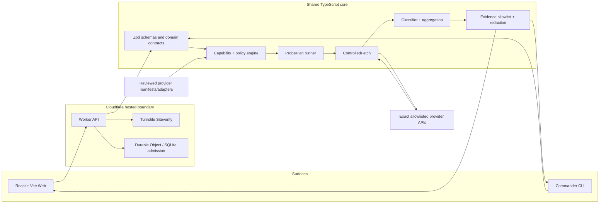

# Architecture Specification

## Architecture invariants

The shared TypeScript core owns semantics. Web and CLI are thin surfaces. Worker is the hosted trust boundary. Only ControlledFetch may call a provider. Core does not import React, Worker-specific APIs, Commander or provider SDKs; runtime ports are injected.

## High-level component map

## Modules and responsibilities

| Area | Owns | Must not own |
|---|---|---|
| `apps/web` | Screens, selection state, safe result rendering, NDJSON consumption | Provider calls, policy truth, credential persistence, classifier logic |
| `apps/worker` | HTTP envelope, Origin/CORS, Turnstile, rate admission orchestration, streaming and platform bindings | Provider-specific classification, bypassing core policy, raw response persistence |
| `apps/cli` | Command parsing, local secret input, workspace scanner, terminal/text/JSON output, exit codes | Core policy duplication, provider-specific network code |
| `packages/core` | Canonical domain contracts, schemas, policy, intent validation, plan execution, timeout/cancellation, aggregation, evidence and redaction | UI/framework/provider SDK imports, runtime globals tied to one deployment platform |
| `packages/provider-kit` | Manifest schema/lint, adapter interface, request/response rules | Arbitrary manifest code execution or host-policy widening |
| `packages/providers` | Seven reviewed provider manifests and specific reviewed adapters | Direct `fetch`, hidden retry or arbitrary host/path/header behavior |
| `packages/catalog` | Catalog and capability data generated from validated manifests | Separate manually maintained capability truth |
| `packages/transport` | Shared NDJSON event contracts and serialization helpers if separation is warranted | Secret-bearing payloads or raw provider data |
| `ControlledFetch` | URL/host/method/header/timeout/redirect/body/response caps and outbound fetch | Business diagnosis or unbounded raw body output |

## Hosted request sequence

1. Worker validates HTTP method, JSON content type, body size, Origin and request schema.
2. Server-side Turnstile Siteverify confirms `success`, expected hostname, expected action, token age/single-use conditions and relevant error codes.
3. Durable Object makes an atomic admission decision for per-source/provider limits, provider budget and idempotency.
4. Shared core validates provider lifecycle, capability, intent parameters, target, risk, side effect, cost, explicit authorization and required billable acknowledgement.
5. Only then does the core materialize the secret, build auth headers and call ControlledFetch.
6. Provider-specific structured evidence is classified before generic HTTP fallback. Secret values and derived values are registered with RedactionContext. Only allowlisted evidence leaves the core.
7. Worker streams ordered `step_started`, `step_completed`, and terminal `final` events, with schema/engine/manifest/aggregation versions. Request-local secret material is discarded as execution ends.

## Local CLI sequence

Parse command/local file without evaluating shell expressions → obtain secret from approved channel → validate schema and policy → run same shared core → ControlledFetch → classify and redact → write sanitized result. No hosted data-plane call by default.

## HTTP API inventory

| Endpoint | Method | Purpose | Release |
|---|---|---|---|
| `/api/test` | POST | One bounded hosted credential test with NDJSON terminal event | P0 hosted |
| `/api/diagnose` | POST | Rule-based diagnosis of error-only input; no credential | P0 |
| `/api/providers` | GET | Safe provider metadata and supported capability list | P0 |
| `/api/providers/:id` | GET | Provider detail: auth type, risk, intents, execution modes | P0 |
| `/api/health` | GET | API HealthLab service health (not external provider credential health) | P0 |
| `/api/status/:provider` | GET | Public provider health signal, independent of credential tests | P1 |
| `/api/models/:provider` | GET | Public model metadata with source/verification time | P1 |

## Transport semantics

- Preflight invalid JSON/schema: HTTP 400; unsupported content type: 415; oversize: 413; Origin/Turnstile refusal: 403; limit: 429 with `Retry-After`. No stream is created for these preflight refusals.
- Accepted policy/intent block: stream a terminal `final`, `overall=SKIPPED`, `runState=BLOCKED` where specified by transport contract.
- Accepted execution: stream ordered `step_started` and `step_completed`, then exactly one terminal `final` if connection permits.
- `final` includes `resultSchemaVersion`, `aggregationPolicyVersion`, engine version and provider-manifest version.
- Use request-local state only; bounded Idempotency-Key state can exist for at most 120 seconds and cannot store raw body/credentials.

## Controlled outbound networking

Hosted HTTPS only; exact bundled provider host allowlist; no IP literals, userinfo, non-default ports or fragments; no arbitrary proxy/socket/DNS settings; `redirect: manual`; GET/POST only for Manifest v1; global header allowlist; `User-Agent: API-HealthLab/<version>`; request body max 32 KiB; decoded response max 128 KiB enforced while streaming; response headers max 128 KiB; JSON nesting max 20; array items max 256; evidence items max 64; extracted strings max 512 chars; default timeout 6 seconds; full hosted budget 8 seconds.

## Provider lifecycle and shutoff

Lifecycle values: `ACTIVE`, `REVIEW`, `DEPRECATED`, `DISABLED`, `REMOVED`. A disabled/removed provider is rejected before secret materialization and no provider request is sent. Operator can disable a provider or hosted credential testing during an incident.

## Dependency direction

Allowed: app → core contracts/use cases; Worker/CLI inject runtime ports; provider kit/manifests are consumed by core runner. Forbidden: core importing React/Worker/Commander/provider SDK, UI importing provider network implementation, provider adapter calling fetch directly. CI should enforce boundaries with lint/static checks.
