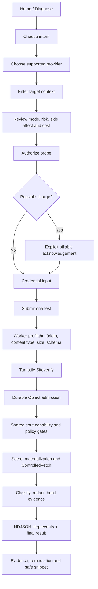
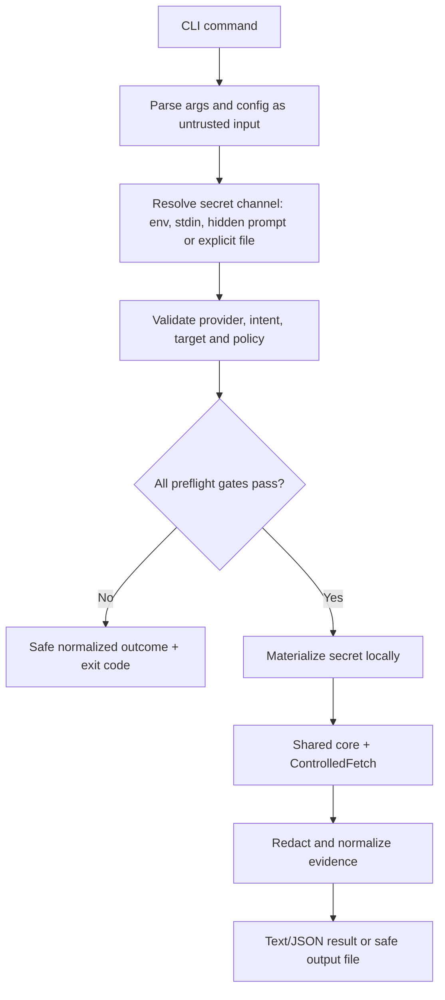

# User Flows

## Flow A — Hosted credential diagnostic

### Required behavior

1. Credential field appears only after intent, provider/target and policy review.
2. Display that hosted credential bytes transiently traverse the Worker; never say the service is unable to see them.
3. Validate everything possible before credential materialization.
4. Invalid content type/schema/Origin, oversized requests, failed Turnstile and rate limits are HTTP refusals without a stream.
5. Once accepted, policy/intent blocks return terminal stream `final` with `overall=SKIPPED`, `runState=BLOCKED`, if this is the defined post-admission path.
6. On success or failure, show normalized status, allowlisted evidence, provider health separately, remediation and a safe statement of what the test did/did not prove.
7. Do not retain the raw credential in browser storage, logs, response, analytics or history.

## Flow B — Local CLI test

The local run must not contact the API HealthLab hosted data plane unless the user explicitly requests a hosted provider-status lookup. Raw keys must never be command-line positional arguments.

## Flow C — Error-only diagnosis

1. User pastes or loads an error message without credentials.
2. Input is size-limited, sanitized and scrubbed for secret-like patterns.
3. Deterministic rules match known status/provider codes and return a stable reason code, explanation and next action.
4. Ambiguous or unknown text returns an inconclusive/unknown diagnosis rather than inventing a root cause.
5. No third-party LLM receives the error text.

## Flow D — Rate-limit / capacity refusal

1. Worker performs cheap preflight checks, then server-side Turnstile verification.
2. Provider-scoped Durable Object atomically applies source/provider and provider-wide admission limits.
3. Rejected request gets HTTP 429 and `Retry-After`, no credential provider call and no NDJSON stream.
4. UI displays a neutral limit message and suggests the local CLI; no credentials are sent to the CLI automatically.

## Flow E — Abort / provider instability

- Abort upstream request via `AbortController` where supported.
- Do not retry automatically.
- If terminal stream delivery remains possible: `runState=ABORTED`, `overall=INCONCLUSIVE`, `reasonCode=CLIENT_ABORTED`.
- Distinguish provider health signals from credential status; a provider incident must not be misreported as an invalid credential.

## Interaction/accessibility requirements

- Keyboard-operable forms, selectors, consent controls and evidence disclosures.
- Visible focus, logical focus order, label/help/error associations and no color-only status communication.
- Changing intent resets invalid target fields.
- Secrets are masked by default and are never echoed after submit.
- No destructive operation is part of hosted MVP.
